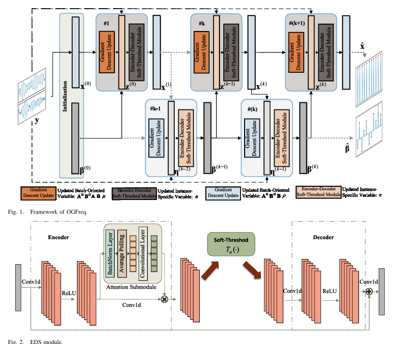
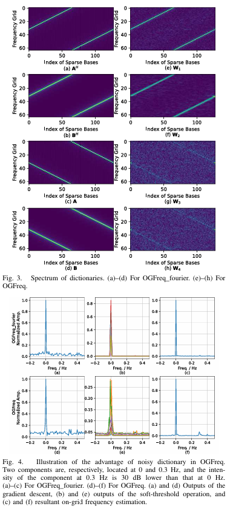
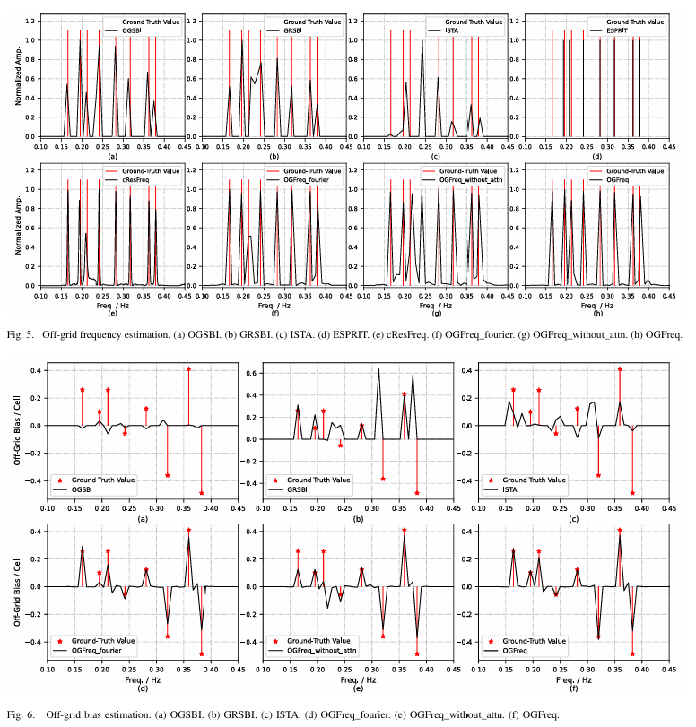
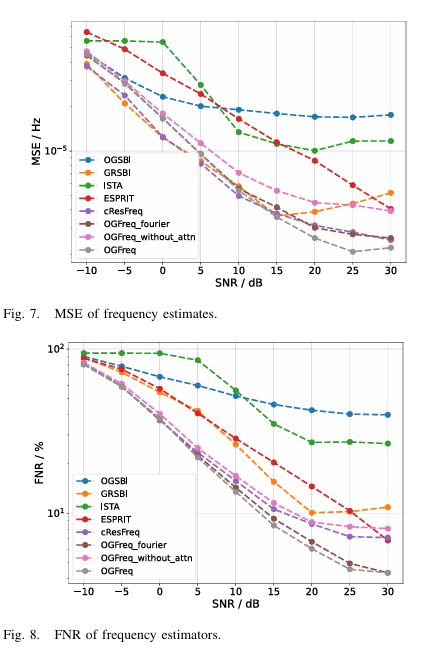
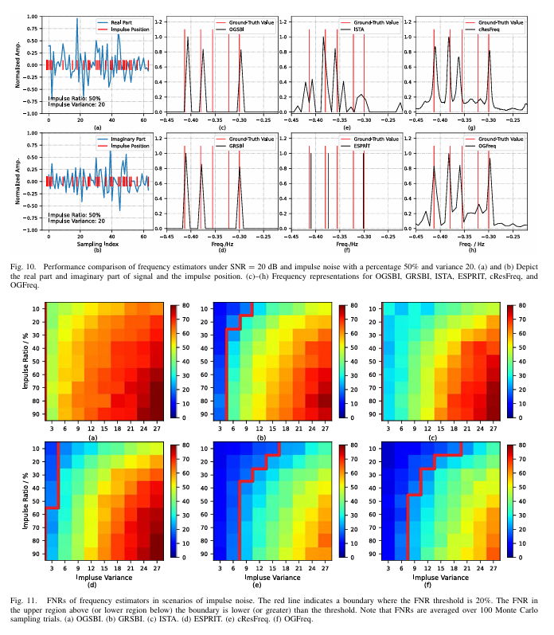
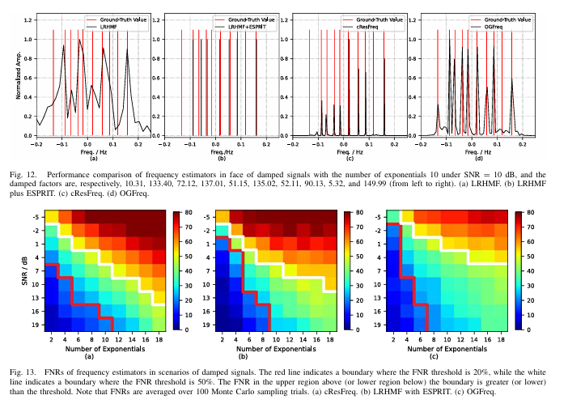

# [Parameter Estimation] Deep Network Based on Explainable Optimization Heuristic for Frequency Estimation [with Python Code]

Abstract: The precision of grid frequency estimation algorithms is limited by the quantization error in discrete grids. This paper proposes a deep neural network for outlier frequency estimation, called OGFreq. In OGFreq, there are two types of variables: one is a batch-oriented frequency domain transformation dictionary, and the other is instance-specific grid frequencies and outlier biases. Since the dictionary needs to be applicable to all observation signals, the network layers and update network weights are designed to approximate the transformation basis data-driven. Additionally, the instance-specific grid frequencies and outlier biases are solved through the iterative soft thresholding algorithm (ISTA) with an attention mechanism-based encoder-decoder soft threshold (EDS) module, and the instance-specific hyperparameters for sparsity are obtained from ISTA. In this way, the dictionary, grid frequencies, and outlier biases are learned within a unified data-driven framework. Numerical experiments show that the FNR of OGFreq decreases by 4% when the SNR is 20 dB; its computational complexity is one order of magnitude lower than that of the iterative outlier frequency estimation algorithm based on iteration. Finally, the robustness of OGFreq under pulse noise and damped signal scenarios is discussed.
Introduction: Frequency estimation is a fundamental problem in the field of signal processing, widely applied in radar, sonar, communication, geophysics, etc. [1]. Frequency estimation was first used in military activities, which is a key issue in radar and sonar technology research. In target detection and tracking, the Doppler frequency of received signals contains the motion state of the target, and precise frequency estimation can avoid trajectory loss caused by large prediction errors. In large-scale multi-input multi-output (MIMO) antenna and communication systems, direction of arrival (DOA) estimation is an important topic in array signal processing, which can be equivalent to time signal frequency estimation problem [2-5]. In addition, sinusoidal signal modeling in audio signal processing is an important method, improving frequency estimation accuracy can help improve audio analysis quality and unsupervised source separation effect [6-9].
Currently, classic frequency estimation algorithms include traditional periodogram methods [10] and super-resolution techniques such as Capon, Multi-Signal Classification (MUSIC), and Rotating Invariant Techniques for Estimating Signal Parameters (ESPRIT) [11-13]. The former two are essentially grid-based methods, while ESPRIT is an ungrid-based method, thus offering higher accuracy. Additionally, Compressed Sensing (CS) or sparse representation theory provides powerful tools for constructing sparse signals. Methods related to these can be categorized into greedy strategies, Sparse Bayesian Learning (SBL) classes, and optimization classes. Among them, Matching Pursuit (MP) and Orthogonal Matching Pursuit (OMP) [14] are classical greedy strategy methods based on SBL distance - velocity estimation (SBL-RV) and Fast SBL-RV (FSBL-RV) [15] are representative SBL methods; Optimization methods have proposed a series of low-rank constraint-based methods for damping index signal recovery [16-18], and the reconstruction signal's frequency estimation is realized through ESPRIT. With the development of deep learning, data-driven complex spatiotemporal neural networks [19], frequency estimators based on deep learning (DeepFreq) [20], complex value residual network for frequency estimation (cResFreq) [21], two-dimensional ResFreq [22], and networks based on Hankel matrix decomposition [23-26] have been successively used for DOA / frequency estimation.
However, in addition to ESPRIT, the above methods are grid-based, facing a common problem: the preset / estimated basis (or steering vector) for sparseness may not match with the actual basis, meaning that the true non-zero components will not fall on the preset / estimated grid [27-31].
To address this issue, various methods have been proposed and mainly applied to DOA estimation, which can be divided into three categories: model-based, data-driven, and a combination of both models and data.
Model-based methods [32-36] rely on empirical assumptions and approximations. Orthogonal Sparse Bayesian Inference (OGSBI) [32] develops iterative algorithms to estimate the Grid DOA and orthogonal deviation from a Bayesian perspective, but the distance between the true DOA and the nearest grid point remains constant, and modeling errors due to orthogonal deviation are always present based on first-order Taylor expansion. Unlike updating orthogonal deviation, Grid Refinement Sparse Bayesian Inference (GRSBI) [36] treats grid point positions as adjustable parameters and iteratively refines, reducing modeling errors. Additionally, considering the computational complexity of complex value dictionaries, researchers explore real-value sparse representation methods [37-39], but despite reduced single-iteration complexity, iterative methods still require significant time for convergence; and in grid refinement methods, dictionaries continuously update and often require matrix inversion, which leads to performance degradation due to singular matrices is another issue to be concerned about.
Data-driven methods treat neural networks as "black boxes," learning linear/nonlinear mappings from observation data to sparse representation through large-scale datasets without explicit modeling knowledge [29,40,41]. However, the generalization capability of the network has not been fully validated in practice, lacks interpretability of network parameters, and requires learning the underlying physical mechanisms of the problem, making it challenging [42].
The method of combining model and data-driven approaches employs deep unfolding technology [43], expanding the iterative sparse representation algorithm into network layers. At the same time, gradient descent is used to update the hyperparameters required by the iterative algorithm in a data-driven manner, thus merging the advantages of both data-driven and model-driven methods. Representative methods include Iterative Sparse Thresholding Algorithm Network (ISTA-Net) [45], Fast Iterative Sparse Thresholding Network (FISTANet) [46], Self-Focusing Network Based on Approximate Message Passing (AMP) [47,48], and Alternating Directions Method of Multipliers Network for CS Model (ADMM-CSNet) [49]. However, the aforementioned methods focus on grid signal recovery. Recently proposed Deep Unfolding Solver for Lack of Information Systems (FOCUSS) Network and Deep Unfolding ADMM Network [50] integrate nested arrays and first-order Taylor expansion decoupling models to establish high-performance DOA estimation methods. However, the matrix inversion during iteration consumes time, and the scalarization of manifold dictionaries also requires memory.
In summary, the above model and data-driven method can be improved in the following two aspects:
1  
Enhance Network Learning Capability: Existing methods only learn a small number of adjustable hyperparameters, and the dictionary required for frequency domain transformation is preset in advance. This undermines the deep learning's powerful feature extraction capabilities, leading to its underestimation compared to traditional adaptive optimization algorithms.
2  
Enhanced Performance Stability: When matrix inversion is required, the learned dictionary may lead to malformed problems of matrix inversion, causing the network to fail to converge.
To address the aforementioned issues, this paper proposes a novel deep-folding architecture for outlier frequency estimation, termed OGFreq. Initially, an outlier model is studied, separating the variables to be estimated into batch-wise and instance-specific categories; subsequently, convolutional layers are designed and their convolutional weights are updated to approximate the dictionary for batch-wise processing. The grid frequency and outlier bias are solved by unfolding ISTA into a deep network architecture. Notably, an EDS module with attention mechanism is designed to achieve instance-specific sparsity. Ultimately, both batch-wise and instance-specific variables learn within a unified framework. Compared to existing methods, the advantage of OGFreq is reflected in:
1  
Higher Network Learning Depth: Separate variables into batch-wise and instance-specific categories for separate solutions. Specifically, since the transformation basis is highly correlated with all signals, features for batches are obtained through designing network layers; meanwhile, instance-specific features such as sparse thresholds, grid frequencies, and outlier biases are acquired using deep expansion techniques with attention modules.
2  
Stability Improvement: Although the learned dictionary in network training can be continuously updated, the ISTA iterative process does not require matrix inversion, avoiding the ill-conditioning issues of matrix inversion.
3  
Enhanced flexibility and generality: OGFreq has a lower false negative rate (FNR) when dealing with damping signals or impulse noise compared to existing methods.
Conclusion This paper proposes an OGFreq framework based on deep learning for out-of-grid frequency estimation. In OGFreq, the out-of-grid model is first studied, with variables divided into batch-specific and instance-specific categories, followed by separate solutions. Specifically, the dictionary used for frequency domain transformation is updated through the update of convolutional layer network weights; grid frequency estimation and out-of-grid bias estimation, due to their instance statistical characteristics, are solved by unfolding the ISTA algorithm into cascaded network modules; moreover, the instance-specific hyperparameters used in ISTA for sparsity are updated through the EDS module with attention mechanism. Finally, all variables are learned through end-to-end training within a unified framework. Numerical experiments show that under coarse sampling grids, the proposed OGFreq has advantages in frequency estimation accuracy and reducing FNR. Finally, the robustness of OGFreq extended to pulse noise and damped signal scenarios is discussed.

## Images

<!-- PAYMENT_BLOCK -->

## Get this dataset

- Payment link (Stripe): [Buy now](https://buy.stripe.com/3cs8yP7sY87d0vu9AB)
- Payment QR code: 

<!-- /PAYMENT_BLOCK -->
